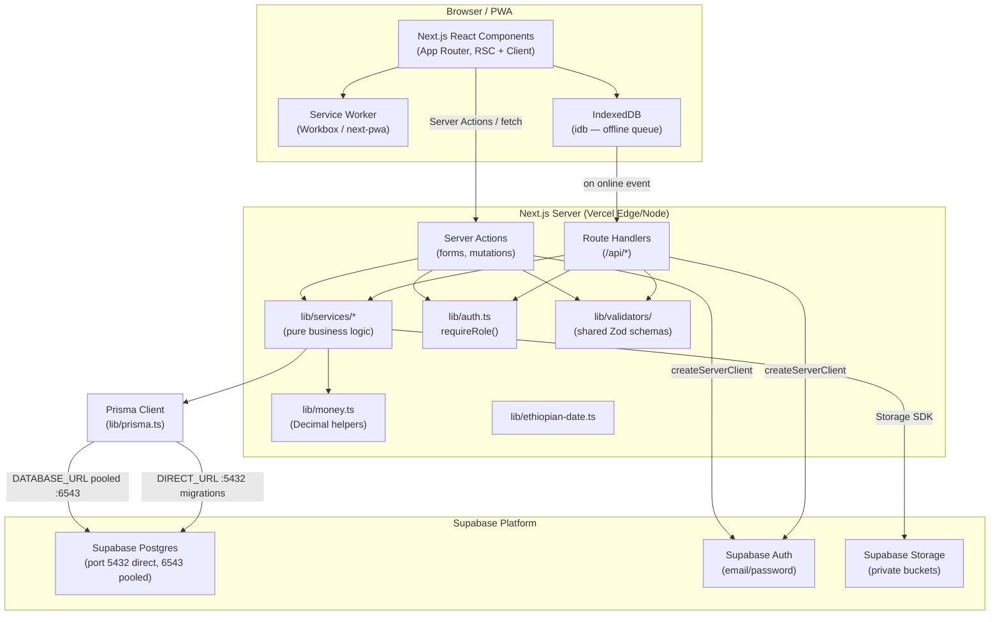
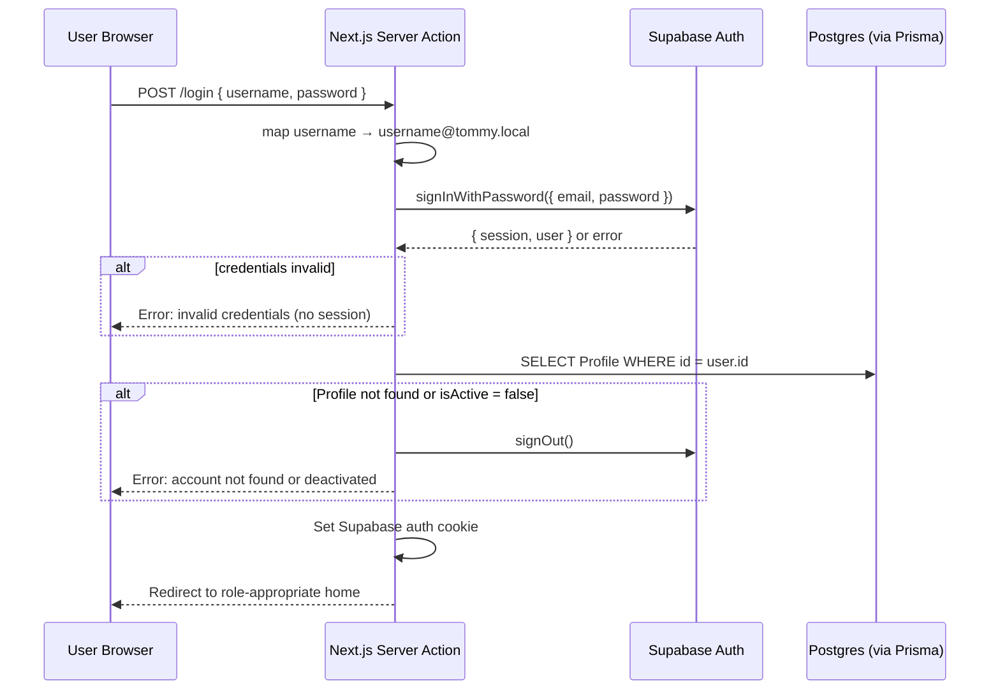
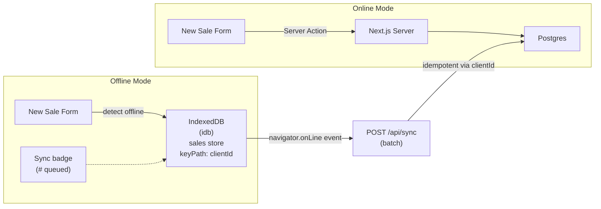
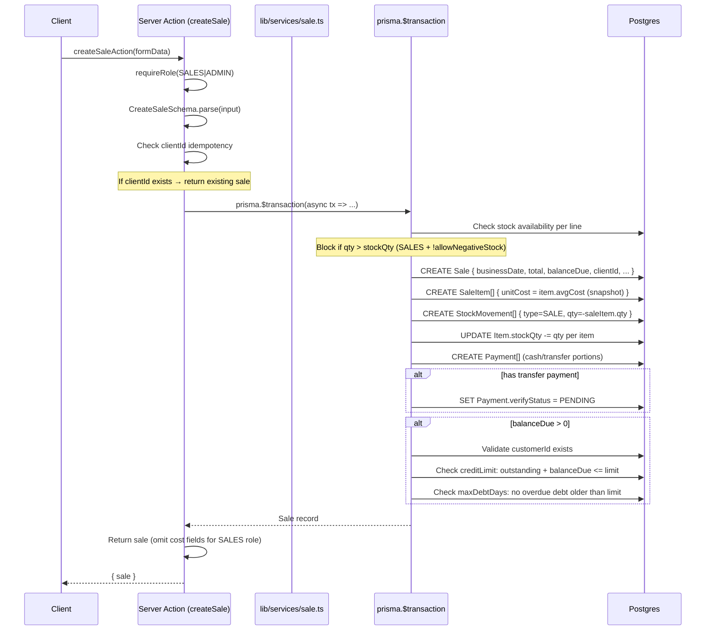
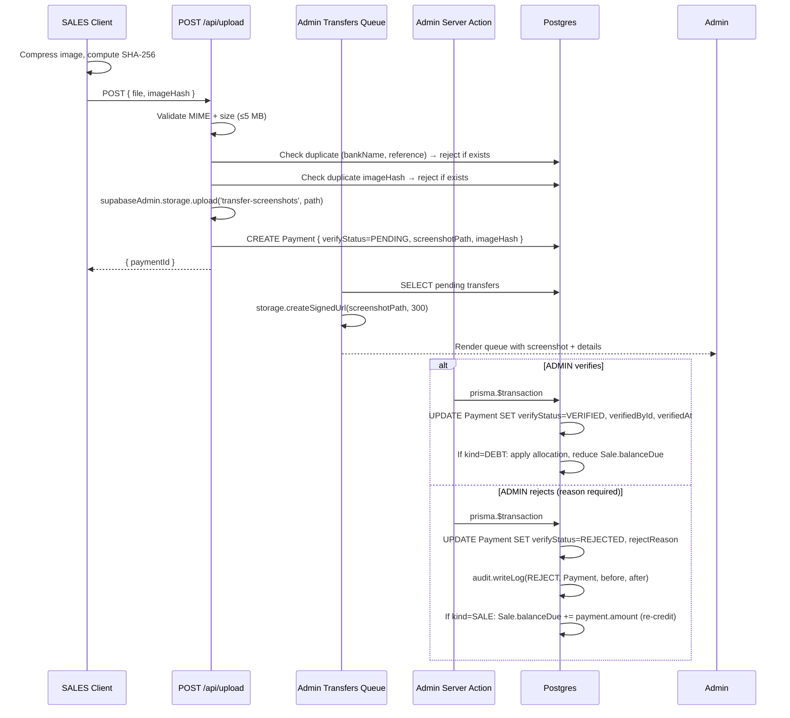
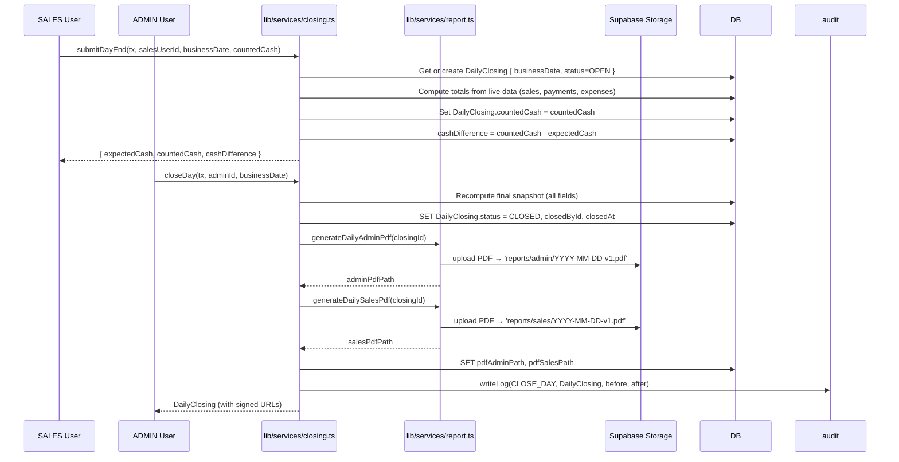
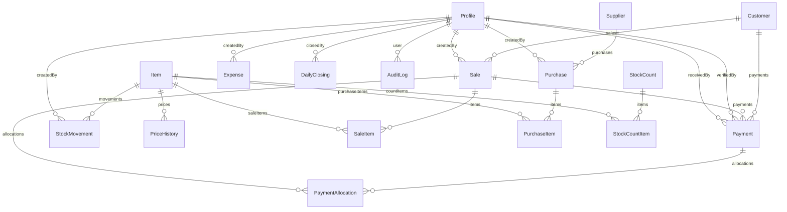

# Design Document — Tommy Market

## Overview

Tommy Market is a production-ready sales, inventory, credit and transfer-verification web application for a small Ethiopian food shop. The system replaces a manual daily-chat reporting workflow with a structured, role-controlled digital system supporting two roles (ADMIN and SALES), offline-first PWA operation, Ethiopian calendar display, and exact decimal arithmetic throughout.

The design follows a Next.js 15 App Router architecture with Server Actions and Route Handlers backed by Prisma ORM and Supabase Postgres. All business logic lives in pure service functions that accept a Prisma transaction client, making them independently testable. Authorization is enforced server-side on every action via a `requireRole()` helper.

---

## 1. System Architecture

### 1.1 High-Level Component Diagram



### 1.2 Request Lifecycle

Every mutation follows this exact pipeline:

```
Browser → Server Action / Route Handler
            ↓
         createServerClient (Supabase Auth cookie)
            ↓
         requireRole(role)  ← throws 403 if insufficient
            ↓
         Zod schema.parse(input)  ← throws 400 if invalid
            ↓
         prisma.$transaction(tx => serviceFunction(tx, ...))
            ↓
         revalidatePath / return result
```

For read operations (RSC page data fetching):

```
RSC Page Component (async)
    ↓
requireRole(role)  ← redirect to /login if no session
    ↓
prisma query (with select omitting cost/profit for SALES)
    ↓
render component
```

### 1.3 Authentication Flow



### 1.4 Supabase Storage Integration

```
Client-side (transfer screenshot):
  1. User selects/captures image
  2. Client compresses to ≤5 MB (browser canvas API)
  3. Client computes SHA-256 hash of compressed bytes
  4. Client uploads via Next.js Route Handler POST /api/upload
     (never directly to Supabase from client — avoids exposing service key)
  5. Route Handler validates MIME type + size
  6. Route Handler calls supabaseAdmin.storage
       .from('transfer-screenshots')
       .upload(path, buffer, { contentType })
  7. Route Handler returns { storagePath, imageHash }

Server-side (PDF reports):
  1. Service generates PDF Buffer via @react-pdf/renderer
  2. supabaseAdmin.storage.from('reports').upload(path, pdfBuffer)
  3. Returns signed URL: storage.createSignedUrl(path, 3600)

Signed URL generation (read):
  supabaseAdmin.storage
    .from(bucket)
    .createSignedUrl(path, expiresInSeconds)
```

### 1.5 RLS and Authorization Architecture

Supabase RLS is set to deny-all for the `anon` role on every table so the public API key cannot read application data. All database reads and writes go through Prisma using the service role connection string — Prisma bypasses RLS entirely. Authorization is therefore enforced exclusively in the Next.js server layer via `requireRole()`.

```sql
-- Applied once per table in a migration
ALTER TABLE "Profile" ENABLE ROW LEVEL SECURITY;
CREATE POLICY "deny_anon" ON "Profile" FOR ALL TO anon USING (false);
-- Repeat for every application table
```

### 1.6 PWA and Offline Architecture



Service worker caching strategy:
- **Static assets** (JS, CSS, fonts, images): Cache-First with long TTL
- **RSC page data**: Stale-while-revalidate
- **API/Server Action calls**: Network-only (mutations must be online or queued in IndexedDB)
- **Offline fallback**: `/offline` page served from cache when network fails

---

## 2. Project Structure

```
tommyshop/
├── prisma/
│   ├── schema.prisma           # source of truth for data model
│   ├── seed.ts                 # seed admin, sales user, catalog items
│   └── migrations/             # prisma migrate output
│
├── public/
│   ├── manifest.webmanifest    # PWA manifest
│   ├── sw.js                   # generated service worker
│   └── fonts/
│       └── NotoSansEthiopic-Regular.ttf
│
├── src/
│   ├── app/
│   │   ├── layout.tsx          # root layout (font, theme provider)
│   │   ├── globals.css
│   │   │
│   │   ├── (auth)/
│   │   │   └── login/
│   │   │       ├── page.tsx    # login form (RSC shell + client form)
│   │   │       └── actions.ts  # signIn server action
│   │   │
│   │   ├── (sales)/            # mobile-first layout, bottom tab bar
│   │   │   ├── layout.tsx      # SalesLayout (bottom nav, sync badge)
│   │   │   ├── today/
│   │   │   │   └── page.tsx    # today's totals, sale list, offline queue
│   │   │   ├── sales/
│   │   │   │   └── new/
│   │   │   │       ├── page.tsx
│   │   │   │       └── actions.ts  # createSale server action
│   │   │   ├── stock/
│   │   │   │   └── page.tsx    # stock levels (no cost)
│   │   │   ├── customers/
│   │   │   │   ├── page.tsx    # customer balances
│   │   │   │   └── [id]/
│   │   │   │       └── page.tsx
│   │   │   └── end-of-day/
│   │   │       ├── page.tsx    # counted cash form
│   │   │       └── actions.ts  # submitDayEnd server action
│   │   │
│   │   ├── (admin)/            # responsive layout, left sidebar
│   │   │   ├── layout.tsx      # AdminLayout (sidebar nav)
│   │   │   ├── dashboard/
│   │   │   │   └── page.tsx
│   │   │   ├── transfers/
│   │   │   │   ├── page.tsx    # pending transfers queue
│   │   │   │   └── actions.ts  # verifyTransfer, rejectTransfer, bulkVerify
│   │   │   ├── sales/
│   │   │   │   ├── page.tsx    # sales list with filters
│   │   │   │   └── [id]/
│   │   │   │       ├── page.tsx
│   │   │   │       └── actions.ts  # voidSale server action
│   │   │   ├── inventory/
│   │   │   │   ├── page.tsx
│   │   │   │   ├── purchases/
│   │   │   │   │   ├── page.tsx
│   │   │   │   │   └── actions.ts  # recordPurchase
│   │   │   │   ├── waste/
│   │   │   │   │   └── actions.ts  # recordWaste
│   │   │   │   └── stock-counts/
│   │   │   │       └── actions.ts  # applyStockCount
│   │   │   ├── customers/
│   │   │   │   ├── page.tsx
│   │   │   │   ├── [id]/
│   │   │   │   │   └── page.tsx    # aging, statement PDF, collect payment
│   │   │   │   └── actions.ts      # writeOffDebt, recordDebtPayment
│   │   │   ├── expenses/
│   │   │   │   ├── page.tsx
│   │   │   │   └── actions.ts
│   │   │   ├── reports/
│   │   │   │   └── page.tsx        # download PDF/Excel reports
│   │   │   ├── items/
│   │   │   │   ├── page.tsx
│   │   │   │   └── actions.ts      # updatePrice, toggleActive
│   │   │   ├── users/
│   │   │   │   ├── page.tsx
│   │   │   │   └── actions.ts      # createUser, deactivateUser
│   │   │   ├── audit/
│   │   │   │   └── page.tsx        # audit log viewer
│   │   │   └── health/
│   │   │       └── page.tsx        # invariant health check (ADMIN only)
│   │   │
│   │   └── api/
│   │       ├── sync/
│   │       │   └── route.ts        # POST — offline sale sync
│   │       ├── upload/
│   │       │   └── route.ts        # POST — screenshot upload proxy
│   │       ├── pdf/
│   │       │   └── [closingId]/
│   │       │       └── route.ts    # GET — redirect to signed PDF URL
│   │       └── cron/
│   │           └── route.ts        # POST — nightly unclosed-day check
│   │
│   ├── lib/
│   │   ├── prisma.ts               # PrismaClient singleton
│   │   ├── supabase/
│   │   │   ├── server.ts           # createServerClient (cookies)
│   │   │   ├── client.ts           # createBrowserClient
│   │   │   └── admin.ts            # createClient(SERVICE_ROLE_KEY)
│   │   ├── auth.ts                 # requireRole(), getSession()
│   │   ├── money.ts                # Decimal helpers
│   │   ├── ethiopian-date.ts       # Ge'ez calendar conversion
│   │   ├── services/
│   │   │   ├── sale.ts
│   │   │   ├── payment.ts
│   │   │   ├── inventory.ts
│   │   │   ├── closing.ts
│   │   │   ├── report.ts
│   │   │   └── audit.ts
│   │   └── validators/
│   │       ├── sale.ts             # CreateSaleInput, etc.
│   │       ├── payment.ts
│   │       ├── inventory.ts
│   │       ├── closing.ts
│   │       └── user.ts
│   │
│   └── components/
│       ├── ui/                     # shadcn/ui re-exports
│       ├── sales/                  # SaleForm, ItemTile, PaymentStep, etc.
│       ├── admin/                  # DashboardCard, TransferRow, AgingTable, etc.
│       └── pdf/                    # @react-pdf/renderer components
│           ├── DailyReportAdmin.tsx
│           ├── DailyReportSales.tsx
│           ├── CustomerStatement.tsx
│           └── shared/             # ReportHeader, SummaryCards, etc.
│
├── tests/
│   ├── unit/
│   │   ├── ethiopian-date.test.ts
│   │   ├── money.test.ts
│   │   ├── inventory.test.ts       # weighted avg cost
│   │   ├── sale.test.ts            # stock block, balanceDue
│   │   ├── payment.test.ts         # duplicate detection
│   │   └── closing.test.ts         # expectedCash formula
│   └── integration/
│       └── sale-lifecycle.test.ts  # end-to-end sale → verify → debt → void
│
├── DECISIONS.md
├── .env.example
└── next.config.ts
```

---

## 3. Authentication Design

### 3.1 Username → Email Mapping

Supabase Auth requires an email address. The app has no email infrastructure, so usernames are mapped to synthetic emails:

```typescript
// lib/auth.ts
function usernameToEmail(username: string): string {
  return `${username.toLowerCase().trim()}@tommy.local`;
}
```

User creation (ADMIN creates users):
```typescript
// In createUser server action
const email = usernameToEmail(username);
const { data, error } = await supabaseAdmin.auth.admin.createUser({
  email,
  password,
  email_confirm: true,  // skip confirmation email
});
// Then create Profile row with id = data.user.id
```

Login:
```typescript
const { data, error } = await supabase.auth.signInWithPassword({
  email: usernameToEmail(username),
  password,
});
```

### 3.2 Server-Side Session Validation

Every RSC page and Server Action calls `requireRole()` before doing anything:

```typescript
// lib/auth.ts
import { createServerClient } from './supabase/server';
import { prisma } from './prisma';
import { Role } from '@prisma/client';

export class AuthError extends Error {
  constructor(public status: 401 | 403, message: string) {
    super(message);
  }
}

export async function getSession() {
  const supabase = await createServerClient();
  const { data: { user }, error } = await supabase.auth.getUser();
  if (error || !user) throw new AuthError(401, 'Not authenticated');
  return user;
}

export async function requireRole(minimumRole: Role): Promise<Profile> {
  const user = await getSession();
  const profile = await prisma.profile.findUnique({
    where: { id: user.id, isActive: true },
  });
  if (!profile) throw new AuthError(401, 'Profile not found');

  // Role hierarchy: ADMIN > SALES
  if (minimumRole === 'ADMIN' && profile.role !== 'ADMIN') {
    throw new AuthError(403, 'ADMIN role required');
  }
  return profile;
}
```

Usage in Server Actions:
```typescript
// app/(admin)/sales/[id]/actions.ts
'use server';
export async function voidSaleAction(saleId: string, reason: string) {
  const admin = await requireRole('ADMIN');
  const input = VoidSaleSchema.parse({ saleId, reason });
  await prisma.$transaction(tx => voidSale(tx, admin.id, saleId, reason));
  revalidatePath('/admin/sales');
}
```

Usage in RSC pages:
```typescript
// app/(admin)/dashboard/page.tsx
export default async function DashboardPage() {
  const admin = await requireRole('ADMIN');  // throws → caught by error.tsx
  const data = await getDashboardData();
  return <Dashboard data={data} />;
}
```

Error boundary handles `AuthError`:
```typescript
// app/error.tsx
if (error instanceof AuthError && error.status === 401) {
  redirect('/login');
}
// 403 renders an "Access Denied" page
```

### 3.3 Cost/Profit Field Exclusion for SALES Role

The exclusion happens at the Prisma query level, not in the UI. Service functions accept the caller's role and apply a conditional `select`:

```typescript
// lib/services/sale.ts
function saleSelect(role: Role) {
  const base = {
    id: true, number: true, businessDate: true, total: true,
    balanceDue: true, paidAmount: true, status: true, note: true,
    createdAt: true, createdBy: { select: { fullName: true } },
    items: {
      select: {
        id: true, qty: true, unitPrice: true, lineTotal: true,
        item: { select: { name: true, nameAm: true, unit: true } },
        // unitCost: excluded for SALES
        ...(role === 'ADMIN' ? { unitCost: true } : {}),
      },
    },
  };
  return base;
}

export async function getSaleForRole(saleId: string, role: Role) {
  return prisma.sale.findUniqueOrThrow({
    where: { id: saleId },
    select: saleSelect(role),
  });
}
```

The `avgCost` field on `Item` is similarly excluded from all item queries returned to SALES users:

```typescript
function itemSelect(role: Role) {
  return {
    id: true, name: true, nameAm: true, unit: true, category: true,
    sellPrice: true, stockQty: true, lowStockLevel: true, isActive: true,
    ...(role === 'ADMIN' ? { avgCost: true } : {}),
  };
}
```

---

## 4. Data Flow Designs

### 4.1 Sale Creation Flow



**Idempotency check (before transaction):**
```typescript
const existing = await prisma.sale.findUnique({
  where: { clientId: input.clientId },
  select: saleSelect(role),
});
if (existing) return existing; // early return — no transaction
```

### 4.2 Transfer Verification Flow



**Duplicate check implementation:**
```typescript
// In /api/upload route handler
const duplicateRef = await tx.payment.findUnique({
  where: { bankName_reference: { bankName, reference } },
  select: { id: true, createdAt: true, receivedBy: { select: { fullName: true } } },
});
if (duplicateRef) {
  throw new ConflictError(
    `Reference already used by ${duplicateRef.receivedBy.fullName} on ${duplicateRef.createdAt}`
  );
}

const duplicateHash = await tx.payment.findUnique({
  where: { imageHash },
  select: { id: true, createdAt: true, receivedBy: { select: { fullName: true } } },
});
if (duplicateHash) {
  throw new ConflictError(
    `Screenshot already uploaded by ${duplicateHash.receivedBy.fullName} on ${duplicateHash.createdAt}`
  );
}
```

### 4.3 Debt Payment Flow

```typescript
// lib/services/payment.ts
export async function allocateDebtPayment(
  tx: PrismaTransaction,
  paymentId: string,
  customerId: string,
  salesOverride?: string[]  // optional manual sale selection
): Promise<void> {
  const payment = await tx.payment.findUniqueOrThrow({ where: { id: paymentId } });

  // Only allocate VERIFIED transfers or CASH payments
  if (payment.method === 'TRANSFER' && payment.verifyStatus !== 'VERIFIED') {
    return; // pending/rejected transfers do not reduce balanceDue
  }

  // Get unpaid sales: oldest first (by businessDate) unless override provided
  const unpaidSales = salesOverride
    ? await tx.sale.findMany({
        where: { id: { in: salesOverride }, customerId, balanceDue: { gt: 0 } },
        orderBy: { businessDate: 'asc' },
      })
    : await tx.sale.findMany({
        where: { customerId, balanceDue: { gt: 0 }, status: 'COMPLETED' },
        orderBy: { businessDate: 'asc' },
      });

  let remaining = new Decimal(payment.amount);

  for (const sale of unpaidSales) {
    if (remaining.lte(0)) break;
    const applied = Decimal.min(remaining, new Decimal(sale.balanceDue));

    await tx.paymentAllocation.create({
      data: { paymentId, saleId: sale.id, amount: applied },
    });
    await tx.sale.update({
      where: { id: sale.id },
      data: {
        balanceDue: new Decimal(sale.balanceDue).sub(applied),
        paidAmount: new Decimal(sale.paidAmount).add(applied),
      },
    });
    remaining = remaining.sub(applied);
  }
}
```

### 4.4 Daily Closing Flow



**expectedCash formula:**
```typescript
const expectedCash = cashReceived      // cash sales payments + cash DEBT payments
  .sub(cashExpenses);                  // cash expenses for the day
// cashDifference = countedCash - expectedCash
```

### 4.5 Weighted Average Cost Update

```typescript
// lib/services/inventory.ts
function computeNewAvgCost(
  oldQty: Decimal,
  oldAvg: Decimal,
  inQty: Decimal,
  inCost: Decimal
): Decimal {
  if (oldQty.lte(0)) {
    return inCost;
  }
  // newAvg = (oldQty * oldAvg + inQty * inCost) / (oldQty + inQty)
  return oldQty.mul(oldAvg).add(inQty.mul(inCost)).div(oldQty.add(inQty));
}
```

Applied atomically inside the purchase transaction:
```typescript
await tx.item.update({
  where: { id: itemId },
  data: {
    avgCost: computeNewAvgCost(
      new Decimal(item.stockQty),
      new Decimal(item.avgCost),
      new Decimal(purchaseItem.qty),
      new Decimal(purchaseItem.unitCost)
    ),
    stockQty: { increment: purchaseItem.qty },
  },
});
```

### 4.6 Sale Void Flow

```typescript
// lib/services/sale.ts
export async function voidSale(
  tx: PrismaTransaction,
  adminId: string,
  saleId: string,
  reason: string
): Promise<void> {
  const sale = await tx.sale.findUniqueOrThrow({
    where: { id: saleId },
    include: { items: true },
  });
  if (sale.status === 'VOIDED') throw new Error('Sale already voided');

  const before = { ...sale };

  // 1. Mark as voided
  await tx.sale.update({
    where: { id: saleId },
    data: {
      status: 'VOIDED',
      voidedAt: new Date(),
      voidedById: adminId,
      voidReason: reason,
      balanceDue: new Decimal(0),
    },
  });

  // 2. Create SALE_VOID movements and restore stockQty
  for (const item of sale.items) {
    await tx.stockMovement.create({
      data: {
        itemId: item.itemId,
        type: 'SALE_VOID',
        qty: item.qty,  // positive — restoring stock
        businessDate: sale.businessDate,
        createdById: adminId,
        refType: 'Sale',
        refId: saleId,
      },
    });
    await tx.item.update({
      where: { id: item.itemId },
      data: { stockQty: { increment: item.qty } },
    });
  }

  // 3. Audit log
  const after = await tx.sale.findUniqueOrThrow({ where: { id: saleId } });
  await writeLog(tx, adminId, 'VOID', 'Sale', saleId, before, after);
}
```

---

## 5. Key Services API

### 5.1 `lib/services/sale.ts`

```typescript
import { PrismaTransaction } from '../prisma';
import { Role, Sale, SaleStatus } from '@prisma/client';

export type CreateSaleInput = {
  clientId: string;
  businessDate: Date;
  customerId?: string;
  items: Array<{
    itemId: string;
    qty: Decimal;
    unitPrice: Decimal;
  }>;
  payments: Array<{
    method: 'CASH' | 'TRANSFER';
    amount: Decimal;
    bankName?: string;
    reference?: string;
    screenshotPath?: string;
    imageHash?: string;
  }>;
  note?: string;
  adminOverrideCreditLimit?: boolean;
  adminOverrideMaxDebtDays?: boolean;
};

export type SaleWithItems = Sale & {
  items: SaleItemWithItem[];
  payments: Payment[];
};

// Creates a new sale inside the provided transaction.
// Role determines: stock blocking behavior, field visibility in return value.
export async function createSale(
  tx: PrismaTransaction,
  userId: string,
  role: Role,
  input: CreateSaleInput
): Promise<SaleWithItems>;

// Sets Sale.status = VOIDED, creates SALE_VOID movements, reverses credit.
// Requires reason. Writes AuditLog. Throws if already voided.
export async function voidSale(
  tx: PrismaTransaction,
  adminId: string,
  saleId: string,
  reason: string
): Promise<void>;

// Returns a sale with fields filtered by role (omits unitCost, avgCost for SALES).
export async function getSaleForRole(
  saleId: string,
  role: Role
): Promise<SaleWithItems>;
```

### 5.2 `lib/services/payment.ts`

```typescript
export type CreatePaymentInput = {
  kind: 'SALE' | 'DEBT';
  method: 'CASH' | 'TRANSFER';
  amount: Decimal;
  businessDate: Date;
  saleId?: string;        // kind=SALE
  customerId?: string;    // kind=DEBT
  bankName?: string;
  reference?: string;
  screenshotPath?: string;
  imageHash?: string;
};

// Creates a payment row. For TRANSFER: sets verifyStatus=PENDING.
// Checks (bankName, reference) uniqueness and imageHash uniqueness.
export async function createPayment(
  tx: PrismaTransaction,
  userId: string,
  input: CreatePaymentInput
): Promise<Payment>;

// Sets verifyStatus=VERIFIED, records verifier and timestamp.
// If kind=DEBT and payment is VERIFIED: triggers allocation.
export async function verifyTransfer(
  tx: PrismaTransaction,
  adminId: string,
  paymentId: string
): Promise<void>;

// Sets verifyStatus=REJECTED, requires reason, writes AuditLog.
// If kind=SALE: re-adds amount to Sale.balanceDue.
export async function rejectTransfer(
  tx: PrismaTransaction,
  adminId: string,
  paymentId: string,
  reason: string
): Promise<void>;

// Allocates a DEBT payment to unpaid sales (oldest-first or manual override).
// Only executes if payment is CASH or VERIFIED TRANSFER.
export async function allocateDebtPayment(
  tx: PrismaTransaction,
  paymentId: string,
  customerId: string,
  salesOverride?: string[]
): Promise<void>;
```

### 5.3 `lib/services/inventory.ts`

```typescript
export type CreatePurchaseInput = {
  supplierId?: string;
  purchaseDate: Date;
  items: Array<{
    itemId: string;
    qty: Decimal;        // must be > 0
    unitCost: Decimal;
  }>;
  note?: string;
  amountPaid?: Decimal;
};

export type WasteInput = {
  itemId: string;
  qty: Decimal;          // positive; stored as negative movement
  reason: string;        // 'spoiled' | 'trimmed' | 'sample' | 'other'
  businessDate: Date;
  note?: string;
};

export type ReconcileReport = {
  discrepancies: Array<{
    itemId: string;
    name: string;
    cachedQty: Decimal;
    computedQty: Decimal;
    difference: Decimal;
  }>;
  checkedAt: Date;
};

// Creates Purchase + PurchaseItem rows, PURCHASE StockMovements,
// updates Item.avgCost (weighted average) and Item.stockQty.
export async function recordPurchase(
  tx: PrismaTransaction,
  adminId: string,
  input: CreatePurchaseInput
): Promise<Purchase>;

// Creates a WASTE StockMovement with negative qty. Updates stockQty.
export async function recordWaste(
  tx: PrismaTransaction,
  adminId: string,
  input: WasteInput
): Promise<StockMovement>;

// Creates COUNT_ADJUSTMENT movements for all items with differences.
// Sets StockCount.applied = true. Updates Item.stockQty.
export async function applyStockCount(
  tx: PrismaTransaction,
  adminId: string,
  stockCountId: string
): Promise<void>;

// Recomputes Item.stockQty from SUM(StockMovement.qty) for all items.
// Reports discrepancies. Does NOT write to DB (read-only report).
export async function reconcileStock(): Promise<ReconcileReport>;
```

### 5.4 `lib/services/closing.ts`

```typescript
// Records the SALES user's end-of-day cash count.
// Creates or updates DailyClosing with live computed totals.
// Returns { expectedCash, countedCash, cashDifference }.
export async function submitDayEnd(
  tx: PrismaTransaction,
  salesUserId: string,
  businessDate: Date,
  countedCash: Decimal
): Promise<DailyClosing>;

// Saves the final snapshot, generates PDFs, marks status=CLOSED.
// Writes AuditLog. Returns DailyClosing with signed PDF URLs.
export async function closeDay(
  tx: PrismaTransaction,
  adminId: string,
  businessDate: Date
): Promise<DailyClosing>;

// Sets status=OPEN, increments pdfVersion, writes AuditLog.
// Requires reason (throws if empty).
export async function reopenDay(
  tx: PrismaTransaction,
  adminId: string,
  businessDate: Date,
  reason: string
): Promise<DailyClosing>;
```

### 5.5 `lib/services/report.ts`

```typescript
// Generates Admin PDF, uploads to 'reports' bucket, returns signed URL.
// Includes cost, profit, margin data.
export async function generateDailyAdminPdf(closingId: string): Promise<string>;

// Generates Sales PDF (no cost/profit), uploads, returns signed URL.
export async function generateDailySalesPdf(closingId: string): Promise<string>;

// Generates a customer account statement PDF for the given date range.
export async function generateCustomerStatementPdf(
  customerId: string,
  from: Date,
  to: Date
): Promise<string>;
```

### 5.6 `lib/services/audit.ts`

```typescript
// Writes an immutable AuditLog row inside the given transaction.
// Throws on failure (which rolls back the parent transaction).
export async function writeLog(
  tx: PrismaTransaction,
  userId: string,
  action: string,     // 'CREATE' | 'UPDATE' | 'VOID' | 'VERIFY' | 'REJECT' | 'CLOSE_DAY' | ...
  entity: string,     // 'Sale' | 'Payment' | 'Item' | 'Profile' | ...
  entityId: string,
  before: object | null,
  after: object | null
): Promise<void>;
```

---

## 6. Ethiopian Date Utility

### 6.1 Algorithm Overview

The Ethiopian (Ge'ez) calendar has 13 months: 12 months of 30 days each and a 13th month (Pagume) of 5 days (6 in a leap year). Ethiopian New Year (Enkutatash) falls on September 11 or 12 of the Gregorian calendar. The Ethiopian year lags the Gregorian year by 7–8 years depending on the month.

**Gregorian → Ethiopian conversion:**

```typescript
// Ethiopian year starts on:
//   Sept 11 (Gregorian) in non-leap years after Ethiopian leap year
//   Sept 12 (Gregorian) in the year after a Gregorian leap year
// Ethiopian leap year: EY % 4 == 3 (every 4 years, shifted from Gregorian)

function toEthiopian(date: Date): EthDate {
  // Julian Day Number approach for accuracy across all dates
  const jdn = gregorianToJdn(date.getFullYear(), date.getMonth() + 1, date.getDate());
  return jdnToEthiopian(jdn);
}

function toGregorian(eth: EthDate): Date {
  const jdn = ethiopianToJdn(eth.year, eth.month, eth.day);
  const { year, month, day } = jdnToGregorian(jdn);
  return new Date(year, month - 1, day);
}
```

The Julian Day Number (JDN) approach avoids manual edge-case handling and correctly handles leap year boundaries (e.g., the 6-day Pagume in Ethiopian leap years).

**Ethiopian calendar constants:**
- Ethiopian epoch JDN: 1,724,221 (corresponds to 29 August 284 CE Gregorian)
- Months per year: 13 (months 1–12 have 30 days; month 13 has 5 or 6 days)
- Leap year: `ethiopianYear % 4 === 3`

### 6.2 Public API

```typescript
// lib/ethiopian-date.ts

export type EthDate = {
  year: number;    // e.g. 2016
  month: number;   // 1–13
  day: number;     // 1–30 (1–5/6 for month 13)
};

// Converts a JavaScript Date (Gregorian) to Ethiopian calendar date.
export function toEthiopian(date: Date): EthDate;

// Converts an Ethiopian calendar date to a JavaScript Date (Gregorian).
export function toGregorian(eth: EthDate): Date;

// Returns a formatted Ethiopian date string, e.g. "10/02/2016 ዓ.ም"
export function formatEthiopian(date: Date, includeYear?: boolean): string;

// Returns the month name in Amharic (e.g. month 1 → "መስከረም")
export function ethiopianMonthName(month: number): string;

// Checks whether an Ethiopian year is a leap year (Pagume has 6 days).
export function isEthiopianLeapYear(year: number): boolean;
```

### 6.3 Unit Test Cases

```typescript
// tests/unit/ethiopian-date.test.ts

describe('toEthiopian', () => {
  it('converts a known date correctly', () => {
    // September 11, 2023 (Gregorian) = 1 Meskerem 2016 (Ethiopian New Year)
    expect(toEthiopian(new Date(2023, 8, 11))).toEqual({ year: 2016, month: 1, day: 1 });
  });

  it('handles Pagume (13th month)', () => {
    // September 5, 2023 = 30 Pagume 2015 (last day of year before Ethiopian New Year)
    expect(toEthiopian(new Date(2023, 8, 5))).toEqual({ year: 2015, month: 13, day: 5 });
  });

  it('handles Ethiopian leap year (Pagume has 6 days)', () => {
    // 2015 Ethiopian is a leap year (2015 % 4 === 3)
    // September 10, 2023 = day 6 of Pagume 2015
    expect(toEthiopian(new Date(2023, 8, 10))).toEqual({ year: 2015, month: 13, day: 6 });
  });
});

describe('round-trip property', () => {
  // Requirement 12.6: FOR ALL valid Ethiopian calendar dates,
  // toGregorian then toEthiopian should return the original date.
  it('round-trips arbitrary dates', () => {
    // Property tested with fast-check in property tests
    // Manual examples:
    const cases: EthDate[] = [
      { year: 2016, month: 1, day: 1 },
      { year: 2010, month: 7, day: 15 },
      { year: 2015, month: 13, day: 6 },   // leap year Pagume
      { year: 2000, month: 1, day: 1 },
    ];
    cases.forEach(eth => {
      expect(toEthiopian(toGregorian(eth))).toEqual(eth);
    });
  });
});
```

---

## 7. Offline / PWA Architecture

### 7.1 Service Worker Strategy

The app uses `next-pwa` (backed by Workbox) with the following caching configuration:

```javascript
// next.config.ts (via next-pwa)
const withPWA = require('next-pwa')({
  dest: 'public',
  runtimeCaching: [
    {
      // Static assets: JS, CSS, fonts, images
      urlPattern: /\.(js|css|woff2|png|svg|ico)$/,
      handler: 'CacheFirst',
      options: { cacheName: 'static-assets', expiration: { maxAgeSeconds: 86400 * 30 } },
    },
    {
      // RSC page data fetches: stale-while-revalidate
      urlPattern: /\/_next\/data\/.+\.json$/,
      handler: 'StaleWhileRevalidate',
      options: { cacheName: 'page-data' },
    },
    {
      // API routes and Server Actions: network-only (mutations must reach server)
      urlPattern: /\/api\//,
      handler: 'NetworkOnly',
    },
  ],
});
```

### 7.2 IndexedDB Schema

```typescript
// lib/offline/db.ts
import { openDB, DBSchema } from 'idb';

interface TommyDB extends DBSchema {
  sales: {
    key: string;         // clientId (UUID)
    value: {
      clientId: string;
      businessDate: string;  // ISO date string
      items: OfflineSaleItem[];
      payments: OfflinePayment[];
      customerId?: string;
      note?: string;
      createdAt: string;
      status: 'pending' | 'synced' | 'failed';
      syncAttempts: number;
    };
    indexes: { 'by-status': string };
  };
}

export const db = openDB<TommyDB>('tommy-market', 1, {
  upgrade(db) {
    const store = db.createObjectStore('sales', { keyPath: 'clientId' });
    store.createIndex('by-status', 'status');
  },
});

// Add a sale to the queue
export async function queueSale(sale: Omit<TommyDB['sales']['value'], 'status' | 'syncAttempts'>) {
  const idb = await db;
  await idb.add('sales', { ...sale, status: 'pending', syncAttempts: 0 });
}

// Get all pending sales
export async function getPendingSales() {
  const idb = await db;
  return idb.getAllFromIndex('sales', 'by-status', 'pending');
}
```

### 7.3 Sync Queue Processor

```typescript
// lib/offline/sync.ts
export async function syncQueue(): Promise<void> {
  if (!navigator.onLine) return;

  const pending = await getPendingSales();
  if (pending.length === 0) return;

  for (const sale of pending) {
    try {
      const response = await fetch('/api/sync', {
        method: 'POST',
        headers: { 'Content-Type': 'application/json' },
        body: JSON.stringify(sale),
      });

      if (response.ok || response.status === 409) {
        // 200 = new sale created, 409 = idempotent duplicate (both = success)
        await markSaleSynced(sale.clientId);
      } else {
        await incrementSyncAttempts(sale.clientId);
      }
    } catch {
      await incrementSyncAttempts(sale.clientId);
    }
  }
}

// Triggered automatically when connectivity returns
if (typeof window !== 'undefined') {
  window.addEventListener('online', syncQueue);
}
```

**`/api/sync` route handler:**
```typescript
// app/api/sync/route.ts
export async function POST(request: Request) {
  const session = await requireRole('SALES');
  const body = await request.json();
  const input = CreateSaleSchema.parse(body);

  // Idempotency: return existing if clientId already in DB
  const existing = await prisma.sale.findUnique({
    where: { clientId: input.clientId },
  });
  if (existing) {
    return Response.json({ sale: existing }, { status: 200 }); // idempotent success
  }

  const sale = await prisma.$transaction(tx =>
    createSale(tx, session.id, session.role, input)
  );
  return Response.json({ sale }, { status: 201 });
}
```

### 7.4 Sync Status Badge

```typescript
// components/sales/SyncBadge.tsx
'use client';
export function SyncBadge() {
  const [count, setCount] = useState(0);

  useEffect(() => {
    const updateCount = async () => {
      const pending = await getPendingSales();
      setCount(pending.length);
    };
    updateCount();
    window.addEventListener('online', updateCount);
    window.addEventListener('offline', updateCount);
    return () => { /* cleanup */ };
  }, []);

  if (count === 0) return null;
  return (
    <span className="bg-amber-500 text-white text-xs rounded-full px-2 py-0.5">
      {count} pending
    </span>
  );
}
```

---

## 8. UI Layout and Navigation

### 8.1 Sales Layout (Mobile-First)

```
┌─────────────────────────────────┐
│  Tommy Market      🔄 2 pending │  ← Header: shop name + sync badge
├─────────────────────────────────┤
│                                 │
│          Page Content           │
│                                 │
│                                 │
├─────────────────────────────────┤
│  Today │ New Sale│ Stock │ More │  ← Bottom tab bar (min 44px touch targets)
└─────────────────────────────────┘
```

Bottom tabs:
- **Today**: `/sales/today` — daily totals, sale list
- **New Sale**: `/sales/sales/new` — sale entry form
- **Stock**: `/sales/stock` — item quantities, low-stock alerts
- **Customers**: `/sales/customers` — balance list, receive payment
- **End of Day**: `/sales/end-of-day` — counted cash form

### 8.2 Admin Layout (Responsive, Desktop-Optimized)

```
┌──────────┬────────────────────────────────────────┐
│ Tommy    │  Dashboard                              │
│ Market   │                                         │
│          │  ┌──────┐ ┌──────┐ ┌──────┐ ┌──────┐  │
│ Dashboard│  │ Cash │ │Trans │ │Credit│ │Profit│  │
│ Transfers│  └──────┘ └──────┘ └──────┘ └──────┘  │
│ Sales    │                                         │
│ Inventory│  7-day trend chart (Recharts)           │
│ Customers│                                         │
│ Expenses │  Action cards:                          │
│ Reports  │  ⚠ 3 pending transfers                  │
│ Items    │  ⚠ 2 overdue customers                  │
│ Users    │  ⚠ 4 low-stock items                    │
│ Audit    │  ⚠ 1 day not closed                     │
│ Health   │                                         │
└──────────┴────────────────────────────────────────┘
```

### 8.3 Shared UI Elements

- **Ethiopian date toggle**: A `<Toggle>` component that switches all date displays on the page between Ethiopian and Gregorian. State stored in `localStorage` and read on mount.
- **Light/dark mode**: Via `next-themes`, persisted in `localStorage`.
- **Sync status badge**: `SyncBadge` component shown in the header on Sales screens.
- **Minimum viewport**: 360px. Tailwind breakpoints: `sm:640px`, `md:768px`, `lg:1024px`.
- **Touch targets**: All interactive elements ≥ 44×44 px on mobile.

---

## 9. PDF Report Structure

### 9.1 Font Registration

```typescript
// components/pdf/fonts.ts
import { Font } from '@react-pdf/renderer';

Font.register({
  family: 'NotoSansEthiopic',
  src: '/fonts/NotoSansEthiopic-Regular.ttf',
});

Font.register({
  family: 'NotoSansEthiopic',
  src: '/fonts/NotoSansEthiopic-Bold.ttf',
  fontWeight: 'bold',
});
```

### 9.2 Component Hierarchy

```
DailyReportAdmin (Document)
├── ReportHeader
│   ├── ShopName ("Tommy Market" / "ቶሚ ማርኬት")
│   ├── EthiopianDate + GregorianDate
│   ├── PreparedBy (profile.fullName)
│   └── StatusBadge ("CLOSED" or "N transfers pending")
│
├── SummaryCards (7 cards in a row)
│   ├── TotalDailyBirr
│   ├── CashReceived
│   ├── TransferVerified
│   ├── TransferPending
│   ├── CreditGiven
│   ├── DebtCollected
│   └── GrossProfit         ← ADMIN only (excluded from Sales PDF)
│
├── SalesTable
│   ├── SalesTableHeader (Item | Qty | Unit Price | Amount)
│   ├── SalesTableRow[] (one per SaleItem group)
│   ├── ItemSubtotal[] (subtotal per item)
│   └── SalesGrandTotal
│
├── TransfersList
│   └── TransferRow[] (bank | reference | amount | status)
│
├── CreditSummary
│   ├── CreditTakenToday[] (customer, amount)
│   └── DebtPaidToday[] (customer, amount)
│
├── CashCheck
│   ├── ExpectedCash
│   ├── CountedCash
│   └── CashDifference (highlighted if != 0)
│
├── StockSummary           ← ADMIN only
│   ├── LowStockItems[]
│   └── WasteToday[]
│
├── ProfitTable            ← ADMIN only
│   └── ProfitRow[] (item | qty sold | avg cost | sell price | gross profit | margin %)
│
└── ReportFooter
    ├── ReportId + Version
    ├── GeneratedAt (Ethiopian + Gregorian)
    └── QRCode (links to /admin/reports/{closingId})

DailyReportSales (Document)
└── [Same structure as DailyReportAdmin]
    └── [SummaryCards.GrossProfit, StockSummary, ProfitTable EXCLUDED]

CustomerStatement (Document)
├── ReportHeader (customer name, date range)
└── StatementTable
    └── StatementRow[] (date | items | amount | paid | balance)
```

### 9.3 Server-Side Generation Pattern

```typescript
// lib/services/report.ts
import { renderToBuffer } from '@react-pdf/renderer';
import { DailyReportAdmin } from '../../components/pdf/DailyReportAdmin';

export async function generateDailyAdminPdf(closingId: string): Promise<string> {
  const closing = await getClosingData(closingId);  // includes all needed data
  const pdfBuffer = await renderToBuffer(<DailyReportAdmin closing={closing} />);

  const version = closing.pdfVersion + 1;
  const path = `admin/${closing.businessDate}-v${version}.pdf`;

  await supabaseAdmin.storage
    .from('reports')
    .upload(path, pdfBuffer, { contentType: 'application/pdf' });

  const { data } = await supabaseAdmin.storage
    .from('reports')
    .createSignedUrl(path, 3600);  // 1 hour

  await prisma.dailyClosing.update({
    where: { id: closingId },
    data: { pdfAdminPath: path, pdfVersion: version },
  });

  return data.signedUrl;
}
```

---

## 10. Security Patterns

### 10.1 RLS Deny-All Migration

```sql
-- prisma/migrations/YYYYMMDDHHMMSS_enable_rls/migration.sql
-- Enable RLS on all application tables and deny anon access

DO $$
DECLARE
  t text;
BEGIN
  FOR t IN SELECT tablename FROM pg_tables WHERE schemaname = 'public'
  LOOP
    EXECUTE format('ALTER TABLE %I ENABLE ROW LEVEL SECURITY', t);
    EXECUTE format(
      'CREATE POLICY deny_anon ON %I FOR ALL TO anon USING (false)',
      t
    );
  END LOOP;
END $$;
```

### 10.2 requireRole Implementation

See Section 3.2 above. Key design decisions:
- Uses `supabase.auth.getUser()` (verifies JWT server-side, not just decodes it)
- Fetches `Profile` from DB every request to check `isActive` (deactivated users are blocked immediately)
- Throws `AuthError(401)` for unauthenticated, `AuthError(403)` for insufficient role
- Caught by `app/error.tsx` and `app/(sales)/error.tsx` boundaries

### 10.3 Signed URL Generation

```typescript
// lib/supabase/admin.ts
export async function getSignedUrl(
  bucket: 'transfer-screenshots' | 'reports',
  path: string,
  expiresInSeconds = 300
): Promise<string> {
  const { data, error } = await supabaseAdmin.storage
    .from(bucket)
    .createSignedUrl(path, expiresInSeconds);
  if (error || !data) throw new Error(`Failed to generate signed URL: ${error?.message}`);
  return data.signedUrl;
}
```

### 10.4 File Upload Validation

```typescript
// app/api/upload/route.ts
const ALLOWED_TYPES = ['image/jpeg', 'image/png', 'image/webp'];
const MAX_SIZE_BYTES = 5 * 1024 * 1024; // 5 MB

export async function POST(request: Request) {
  const session = await requireRole('SALES');
  const formData = await request.formData();
  const file = formData.get('file') as File;

  if (!ALLOWED_TYPES.includes(file.type)) {
    return Response.json({ error: 'Invalid file type' }, { status: 400 });
  }
  if (file.size > MAX_SIZE_BYTES) {
    return Response.json({ error: 'File too large (max 5 MB)' }, { status: 400 });
  }

  const buffer = Buffer.from(await file.arrayBuffer());

  // Verify imageHash sent by client matches actual file
  const serverHash = createHash('sha256').update(buffer).digest('hex');
  const clientHash = formData.get('imageHash') as string;
  if (serverHash !== clientHash) {
    return Response.json({ error: 'Image hash mismatch' }, { status: 400 });
  }

  // ... upload to storage
}
```

### 10.5 Login Rate Limiting

```typescript
// app/(auth)/login/actions.ts
import { Ratelimit } from '@upstash/ratelimit';  // or use a simple in-memory store
import { headers } from 'next/headers';

// Simple IP-based rate limit: 5 attempts per minute per IP
const rateLimitMap = new Map<string, { count: number; resetAt: number }>();

function checkRateLimit(ip: string): boolean {
  const now = Date.now();
  const entry = rateLimitMap.get(ip);
  if (!entry || now > entry.resetAt) {
    rateLimitMap.set(ip, { count: 1, resetAt: now + 60_000 });
    return true;
  }
  if (entry.count >= 5) return false;
  entry.count++;
  return true;
}

export async function signInAction(formData: FormData) {
  const ip = (await headers()).get('x-forwarded-for') ?? 'unknown';
  if (!checkRateLimit(ip)) {
    return { error: 'Too many login attempts. Please wait 1 minute.' };
  }
  // ... proceed with Supabase auth
}
```

---

## 11. Data Models

The Prisma schema (`docs/schema.prisma`) is the authoritative source of truth for all data models. The following section summarizes the key relationships and design decisions.

### 11.1 Core Entity Relationships



### 11.2 Key Design Decisions

| Decision | Rationale |
|----------|-----------|
| `Item.stockQty` is a cached sum | Avoids expensive SUM aggregates on every stock display. Reconciliation script detects drift. |
| `SaleItem.unitCost` copies `avgCost` at sale time | Profit is immutable once a sale is created — price changes and future purchases don't retroactively change past profit. |
| `Sale.balanceDue` is stored (not purely computed) | Enables efficient queries for overdue credit without full aggregation. Health check verifies it matches `total − paidAmount`. |
| `Payment.imageHash @unique` | Database-level uniqueness prevents the same screenshot being uploaded twice, complementing the application-level check. |
| `Payment.bankName + reference @@unique` | Database-level uniqueness prevents duplicate transfer references at the DB layer. |
| `AuditLog` has no update/delete operations in Prisma schema | The application never issues UPDATE or DELETE on AuditLog — write-only via `writeLog()`. |
| `clientId @unique` on Sale | Idempotency at the DB layer — offline sync cannot create duplicate sales. |

### 11.3 Prisma Client Singleton

```typescript
// lib/prisma.ts
import { PrismaClient } from '@prisma/client';

const globalForPrisma = globalThis as unknown as { prisma?: PrismaClient };

export const prisma =
  globalForPrisma.prisma ??
  new PrismaClient({
    log: process.env.NODE_ENV === 'development' ? ['query', 'error'] : ['error'],
  });

if (process.env.NODE_ENV !== 'production') {
  globalForPrisma.prisma = prisma;
}

export type PrismaTransaction = Parameters<Parameters<PrismaClient['$transaction']>[0]>[0];
```

---

## 12. Correctness Properties

*A property is a characteristic or behavior that should hold true across all valid executions of a system — essentially, a formal statement about what the system should do. Properties serve as the bridge between human-readable specifications and machine-verifiable correctness guarantees.*

This feature uses **Vitest** with **fast-check** for property-based testing. Each property test runs a minimum of 100 iterations.

### Property 1: SALES role field exclusion

*For any* sale created with any combination of items, quantities, and prices, a response returned to a user with the SALES role should contain no `unitCost`, `avgCost`, or profit-derived fields.

**Validates: Requirements 1.5**

---

### Property 2: Admin-only action enforcement

*For any* server action or route handler that requires ADMIN role, calling that action with a SALES session should return a 403 authorization error without executing the action's side effects.

**Validates: Requirements 1.6, 14.6**

---

### Property 3: Audit log written for sensitive actions

*For any* user creation or deactivation action, an AuditLog entry should exist in the database with the acting admin's ID, the ADMIN action type, and before/after Profile state.

**Validates: Requirements 1.8, 11.1**

---

### Property 4: Price change creates PriceHistory and updates Item

*For any* item and any new sell price (different from the current price), changing the price should both create a PriceHistory row recording the previous price and update Item.sellPrice to the new value atomically.

**Validates: Requirements 2.2, 2.3**

---

### Property 5: Low-stock detection

*For any* item where `stockQty ≤ lowStockLevel`, the system's low-stock query should include that item in the low-stock set; for any item where `stockQty > lowStockLevel`, the item should not appear in the low-stock set.

**Validates: Requirements 2.5, 6.9**

---

### Property 6: Sale creation — unitPrice defaults to current sellPrice

*For any* item with any sellPrice, when creating a sale item without specifying a custom unitPrice, the SaleItem.unitPrice stored in the database should equal the item's sellPrice at the time of sale creation.

**Validates: Requirements 3.1**

---

### Property 7: avgCost snapshot at sale time

*For any* item with any avgCost value, when a sale is saved, SaleItem.unitCost should equal the item's avgCost at the moment the transaction commits — regardless of subsequent price changes or purchases.

**Validates: Requirements 3.2**

---

### Property 8: Stock movements created on sale

*For any* sale with N line items, saving the sale should create exactly N StockMovement rows with type=SALE, each with a negative quantity exactly equal to the negative of the corresponding SaleItem.qty.

**Validates: Requirements 3.3**

---

### Property 9: StockQty updated on sale and stockQty invariant

*For any* item and any sale quantity sold, `Item.stockQty` after the sale should equal the previous `stockQty` minus the sold quantity — and should always equal `SUM(StockMovement.qty)` for that item across all movement types.

**Validates: Requirements 3.4, 6.1, 13.3 (health check invariant 1)**

---

### Property 10: Sale total Decimal correctness

*For any* set of sale line items with arbitrary quantities and unit prices (expressed as Decimal values), `Sale.total` should exactly equal `SUM(qty × unitPrice)` with no floating-point rounding error.

**Validates: Requirements 3.5, 13.1**

---

### Property 11: balanceDue arithmetic invariant

*For any* sale with any combination of payment amounts, `Sale.balanceDue` should always equal `Sale.total − SUM(payment.amount)` and should never be negative. This invariant must hold after sale creation, debt payments, and sale voiding.

**Validates: Requirements 3.6, 13.3 (health check invariant 2)**

---

### Property 12: Stock blocking for SALES role

*For any* item where the requested sale quantity exceeds `Item.stockQty`, a SALES user (with allowNegativeStock=false) should be unable to create the sale — the system should return an error without creating any Sale, SaleItem, or StockMovement rows.

**Validates: Requirements 3.8**

---

### Property 13: Sale idempotency via clientId

*For any* valid sale input with a given clientId, submitting the same sale twice (with the same clientId) should return the same sale record both times and result in exactly one Sale row in the database (not two).

**Validates: Requirements 3.10, 3.11, 10.4**

---

### Property 14: Transfer SHA-256 hash stored correctly

*For any* image file (expressed as a byte array), uploading it as a transfer screenshot should store an imageHash equal to `SHA256(imageBytes)` on the Payment row.

**Validates: Requirements 4.1**

---

### Property 15: Transfer duplicate rejection

*For any* (bankName, reference) pair already present in the Payment table, submitting a new transfer with the same pair should be rejected; and for any image whose SHA-256 hash matches an existing Payment's imageHash, the upload should be rejected.

**Validates: Requirements 4.2, 4.3**

---

### Property 16: New transfer always starts as PENDING

*For any* new transfer payment that passes duplicate validation, the Payment.verifyStatus should always be set to PENDING immediately after creation.

**Validates: Requirements 4.4**

---

### Property 17: Transfer verification state transition

*For any* PENDING transfer, after an admin calls verifyTransfer, the Payment.verifyStatus should be VERIFIED with verifiedById and verifiedAt set; for any rejection with a reason, verifyStatus should be REJECTED and an AuditLog entry should exist.

**Validates: Requirements 4.7, 4.8**

---

### Property 18: Bulk verification

*For any* set of PENDING transfers (of any size ≥ 1), bulk verifying them all should result in all of them having verifyStatus=VERIFIED in a single atomic operation.

**Validates: Requirements 4.9**

---

### Property 19: Unverified transfers excluded from revenue

*For any* PENDING or REJECTED transfer, the confirmed revenue total for that business date should not include that transfer's amount; only VERIFIED and CASH payments should contribute to confirmed revenue.

**Validates: Requirements 4.10**

---

### Property 20: Customer outstanding balance calculation

*For any* customer with any set of sales (some voided, some with partial payments), the calculated outstanding balance should equal the sum of `balanceDue` across all non-VOIDED sales for that customer.

**Validates: Requirements 5.1**

---

### Property 21: Credit limit enforcement

*For any* customer where `outstandingBalance + newBalanceDue > creditLimit`, attempting to create a credit sale as a SALES user should be blocked; the same attempt by an ADMIN with explicit override should succeed.

**Validates: Requirements 5.2**

---

### Property 22: Debt age enforcement

*For any* customer who has at least one unpaid sale with `businessDate < today − maxDebtDays`, attempting a new credit sale as a SALES user should be blocked.

**Validates: Requirements 5.3**

---

### Property 23: Debt payment oldest-first allocation

*For any* customer with multiple unpaid sales of varying `businessDate` values, applying a debt payment should reduce `balanceDue` on the oldest sale(s) first, until the payment amount is exhausted.

**Validates: Requirements 5.4**

---

### Property 24: Pending transfer does not reduce balanceDue

*For any* PENDING transfer debt payment, all associated Sale.balanceDue values should remain unchanged until the transfer is verified.

**Validates: Requirements 5.6**

---

### Property 25: Weighted average cost formula

*For any* item with any (oldQty, oldAvg) state and any purchase of (inQty, inCost), the new avgCost should equal `(oldQty × oldAvg + inQty × inCost) / (oldQty + inQty)` when `oldQty > 0`, or `inCost` when `oldQty ≤ 0`.

**Validates: Requirements 6.3**

---

### Property 26: Stock count adjustment movements

*For any* stock count where some items have `countedQty ≠ systemQty`, applying the count should create exactly one COUNT_ADJUSTMENT StockMovement per differing item with `qty = countedQty − systemQty`, and no movement for items where quantities match.

**Validates: Requirements 6.7**

---

### Property 27: Sale void restores stock and clears credit

*For any* voided sale with N line items, N SALE_VOID StockMovements should be created with positive quantities matching the original sale quantities; Item.stockQty should be restored; and if the original sale had `balanceDue > 0`, the customer's outstanding balance should decrease by that amount.

**Validates: Requirements 7.3, 7.4, 7.5**

---

### Property 28: AuditLog written on void

*For any* sale void operation, an AuditLog entry should exist with action=VOID, entity=Sale, entityId equal to the sale's ID, and before/after JSON snapshots.

**Validates: Requirements 7.6, 11.1**

---

### Property 29: Hard delete prevention

*For any* void, rejection, or write-off operation, the original Sale, SaleItem, Payment, and StockMovement rows should still be retrievable from the database after the operation completes.

**Validates: Requirements 7.7**

---

### Property 30: Voided sales excluded from revenue

*For any* set of sales where some are VOIDED, the revenue total, gross profit, and closing snapshot calculations should not include any amount from VOIDED sales.

**Validates: Requirements 7.8, 13.5**

---

### Property 31: expectedCash formula

*For any* business day with any combination of cash sales, cash debt payments, and cash expenses, `expectedCash` should equal `(cashSales + cashDebtPayments) − cashExpenses` with exact Decimal arithmetic.

**Validates: Requirements 8.2**

---

### Property 32: Closed day blocks SALES mutations

*For any* SALES user action (create sale, record payment, add expense) targeting a business date with DayStatus=CLOSED, the action should return an error and not create any database rows.

**Validates: Requirements 8.5**

---

### Property 33: PDF version increment on reopen/close

*For any* DailyClosing that has been reopened and then closed again, `DailyClosing.pdfVersion` should be strictly greater than its value before the reopen/close cycle, and both old and new PDF paths should exist in Supabase Storage.

**Validates: Requirements 8.7**

---

### Property 34: Ethiopian calendar round-trip

*For any* valid Ethiopian calendar date (year 1900–2100 Ethiopian, month 1–13, day 1–30 for months 1–12 or 1–6 for month 13), converting to Gregorian and then back to Ethiopian should produce the original Ethiopian date exactly.

**Validates: Requirements 12.6**

---

### Property 35: Zod server validation is independent of client validation

*For any* server action called with input that bypasses client-side validation (e.g., malformed or missing fields sent directly), the Zod schema on the server should reject the input and return a validation error.

**Validates: Requirements 14.4**

---

## 13. Error Handling

### 13.1 Error Classes

```typescript
// lib/errors.ts
export class AuthError extends Error {
  constructor(public status: 401 | 403, message: string) { super(message); }
}
export class ValidationError extends Error {
  constructor(public issues: ZodIssue[]) { super('Validation failed'); }
}
export class ConflictError extends Error {
  constructor(message: string) { super(message); }
}
export class BusinessRuleError extends Error {
  constructor(message: string) { super(message); }
}
export class NotFoundError extends Error {
  constructor(entity: string, id: string) { super(`${entity} ${id} not found`); }
}
```

### 13.2 Server Action Error Pattern

```typescript
// All server actions return a discriminated union
type ActionResult<T> =
  | { ok: true; data: T }
  | { ok: false; error: string; code: 'AUTH' | 'VALIDATION' | 'CONFLICT' | 'BUSINESS' | 'NOT_FOUND' | 'UNKNOWN' };

// Server actions catch known errors and map them:
export async function createSaleAction(formData: FormData): Promise<ActionResult<Sale>> {
  try {
    // ...
    return { ok: true, data: sale };
  } catch (e) {
    if (e instanceof AuthError) return { ok: false, error: e.message, code: 'AUTH' };
    if (e instanceof ZodError) return { ok: false, error: formatZodError(e), code: 'VALIDATION' };
    if (e instanceof ConflictError) return { ok: false, error: e.message, code: 'CONFLICT' };
    if (e instanceof BusinessRuleError) return { ok: false, error: e.message, code: 'BUSINESS' };
    console.error('Unexpected error in createSaleAction', e);
    return { ok: false, error: 'An unexpected error occurred', code: 'UNKNOWN' };
  }
}
```

### 13.3 Transaction Failure Handling

All Prisma transactions use `prisma.$transaction` which automatically rolls back on any thrown exception. The pattern ensures atomicity:

- If `writeLog` fails → entire parent transaction rolls back (Requirement 11.1)
- If any stock update fails → sale creation rolls back entirely
- If PDF generation fails during `closeDay` → day status remains OPEN (the closing snapshot is written inside the same transaction as the PDF path update)

---

## 14. Testing Strategy

### 14.1 Testing Framework

- **Unit and Property Tests**: Vitest + fast-check
- **Integration Tests**: Vitest with a real Postgres test database (separate `DATABASE_URL_TEST`)
- **Property Test Iterations**: Minimum 100 per property (fast-check default)

### 14.2 Unit Tests

Unit tests cover pure functions that don't require a database:

| File | What is tested |
|------|----------------|
| `tests/unit/ethiopian-date.test.ts` | Gregorian↔Ethiopian conversion, known dates, leap year boundaries, month names |
| `tests/unit/money.test.ts` | Decimal addition/subtraction/multiplication, no floating-point drift, edge cases (zero, very large values) |
| `tests/unit/inventory.test.ts` | `computeNewAvgCost()` formula with various (oldQty, oldAvg, inQty, inCost) combinations including `oldQty ≤ 0` case |
| `tests/unit/closing.test.ts` | `expectedCash` formula: various cash/expense combinations |
| `tests/unit/validators.test.ts` | Zod schema rejection of invalid inputs |

### 14.3 Property-Based Tests

Each property from Section 12 is implemented as a Vitest test using fast-check's `fc.assert(fc.property(...))`:

```typescript
// tests/unit/sale.test.ts (example for Property 10)

import { describe, it } from 'vitest';
import * as fc from 'fast-check';
import Decimal from 'decimal.js';

// Feature: tommy-market, Property 10: Sale total Decimal correctness
describe('Sale total Decimal correctness', () => {
  it('total equals sum of qty * unitPrice for any line items', () => {
    fc.assert(fc.property(
      fc.array(
        fc.record({
          qty: fc.float({ min: 0.001, max: 999.999, noNaN: true }).map(n => new Decimal(n.toFixed(3))),
          unitPrice: fc.float({ min: 1, max: 99999, noNaN: true }).map(n => new Decimal(n.toFixed(2))),
        }),
        { minLength: 1, maxLength: 10 }
      ),
      (items) => {
        const expectedTotal = items.reduce(
          (sum, item) => sum.add(item.qty.mul(item.unitPrice)),
          new Decimal(0)
        );
        const computedTotal = computeSaleTotal(items);
        return computedTotal.equals(expectedTotal);
      }
    ), { numRuns: 200 });
  });
});
```

**Property test tags** (in test descriptions):
- Format: `Feature: tommy-market, Property {N}: {property_text}`
- Example: `Feature: tommy-market, Property 25: Weighted average cost formula`

### 14.4 Integration Test

```typescript
// tests/integration/sale-lifecycle.test.ts
// Tests the full sale → verify → debt → void lifecycle

describe('Sale lifecycle integration', () => {
  it('creates a split sale, verifies transfer, pays debt, voids another sale', async () => {
    // 1. Create items and customer with known state
    // 2. Create sale with cash + transfer + credit split
    //    Assert: Sale.total = cash + transfer + credit
    //    Assert: SaleItem.unitCost = item.avgCost at sale time
    //    Assert: StockMovements created, Item.stockQty decremented
    //    Assert: Payment.verifyStatus = PENDING for transfer
    //
    // 3. Verify the transfer
    //    Assert: Payment.verifyStatus = VERIFIED
    //    Assert: confirmed revenue increases
    //
    // 4. Create a second sale on credit only
    // 5. Record a DEBT payment for the customer
    //    Assert: oldest sale's balanceDue reduced first
    //    Assert: PaymentAllocation rows created
    //
    // 6. Void the second sale
    //    Assert: Sale.status = VOIDED
    //    Assert: SALE_VOID movements created with positive qty
    //    Assert: Item.stockQty restored
    //    Assert: Customer outstanding balance reduced by voided sale's balanceDue
    //    Assert: AuditLog entry exists for void
    //
    // 7. Compute closing totals
    //    Assert: voided sale NOT in totalSales or grossProfit
    //    Assert: expectedCash formula is correct
    //    Assert: Health check invariants all pass
  });
});
```

### 14.5 Health Check Invariants

Exposed at `/admin/health` (ADMIN only) and also runnable as a Vitest test:

```typescript
// lib/health.ts
export async function checkInvariants(): Promise<HealthReport> {
  const [stockDrift, balanceDrift, duplicateRefs, duplicateHashes] = await Promise.all([
    // Invariant 1: Item.stockQty == SUM(StockMovement.qty)
    checkStockQtyInvariant(),
    // Invariant 2: Sale.balanceDue == Sale.total - Sale.paidAmount (non-voided)
    checkBalanceDueInvariant(),
    // Invariant 3: No duplicate (bankName, reference) in Payment
    checkDuplicateReferenceInvariant(),
    // Invariant 4: No duplicate imageHash in Payment
    checkDuplicateImageHashInvariant(),
  ]);

  return {
    healthy: [stockDrift, balanceDrift, duplicateRefs, duplicateHashes].every(r => r.ok),
    checks: { stockDrift, balanceDrift, duplicateRefs, duplicateHashes },
    checkedAt: new Date(),
  };
}
```

### 14.6 Test Coverage Targets

| Layer | Target |
|-------|--------|
| `lib/services/*` (pure service functions) | ≥ 90% branch coverage |
| `lib/ethiopian-date.ts` | 100% (all calendar edge cases) |
| `lib/money.ts` | 100% |
| Property tests | 1 test per property in Section 12 |
| Integration | 1 full lifecycle test covering the happy path + all void/verify/debt paths |

---

## 15. Key Design Decisions

| Decision | Rationale |
|----------|-----------|
| Server Actions over REST for mutations | Eliminates separate API layer for form submissions; type-safe with Zod; works with Next.js revalidation. Route Handlers used only for file upload proxy, PDF download, sync, and cron. |
| Pure service functions taking `PrismaTransaction` | Fully testable in isolation with a mock/real tx; server actions are thin orchestrators. |
| SHA-256 hash computed server-side (verified against client hash) | Client provides hash for fast duplicate checking; server recomputes to prevent hash spoofing. |
| `PriceHistory` row on every sell price change | Enables point-in-time price lookup and complete audit history for pricing decisions. |
| Pagume month 13 included in calendar | Ethiopian calendar has 13 months; ignoring month 13 would break date display for ~5 days per year. |
| `idb` for IndexedDB | Type-safe, promise-based wrapper; significantly better DX than raw IndexedDB API. |
| PDFs generated on the server (not client) | `@react-pdf/renderer` on server avoids client-side font loading and PDF size issues; works on Vercel serverless. |
| Decimal.js via Prisma Decimal type | Native JavaScript numbers cannot represent ETB amounts like 4.70 kg × 700 ETB exactly; Prisma's Decimal wraps decimal.js for all DECIMAL(x,y) columns. |
